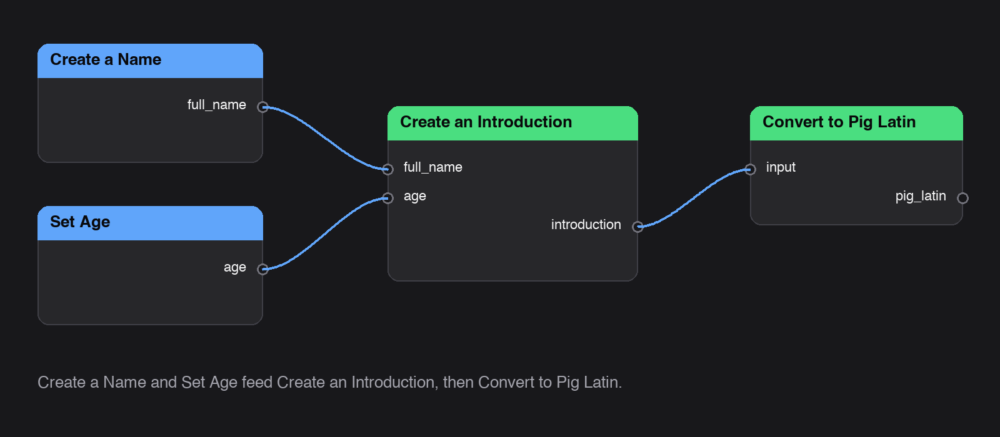

# Getting started

This builds a workflow that turns a name and an age into a sentence like "Hey! My name is Maria Lopez, and I'm 34 years old."

1. Add a [Create a Name](../nodes/CreateName.md) node. Type a first and last name. It capitalizes both and joins them into `full_name`.
1. Add a [Set Age](../nodes/set_age.md) node and drag the slider to an age.
1. Add a [Create an Introduction](../nodes/control/create_an_introduction.md) node.
1. Connect `full_name` from **Create a Name** to `full_name` on the introduction, and `age` from **Set Age** to `age`.
1. Run the introduction node. Its `introduction` output has your sentence.

Want it in pig latin? Connect `introduction` to a [Convert to Pig Latin](../nodes/control/ConvertToPigLatin.md) node. The finished version is the [Introduce Yourself in Pig Latin](../workflows/introduce_yourself_in_pig_latin.md) template.

## One node instead of three

[Introduce Yourself](../workflow_nodes/IntroduceYourself.md) is a saved workflow that behaves like a single node. It takes a first name, a last name, and an age, and returns the introduction.
